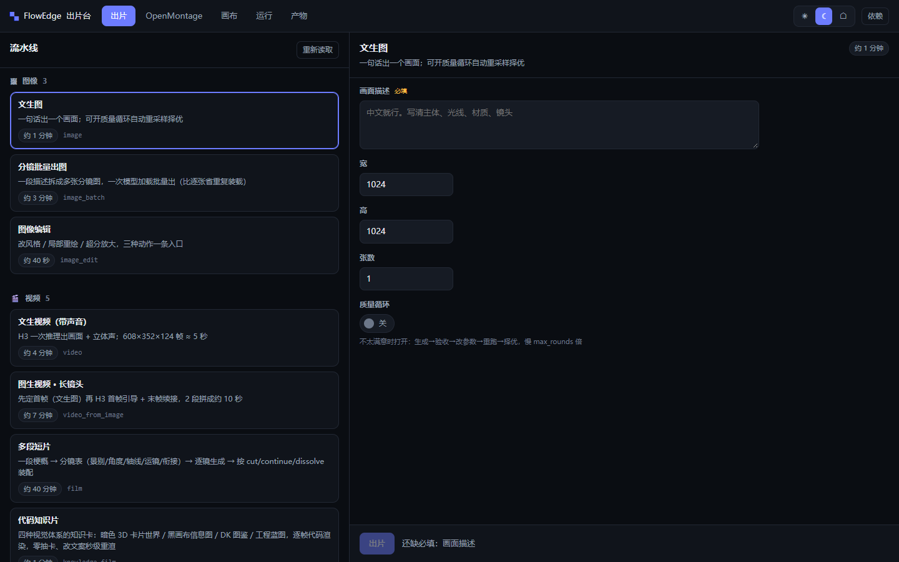
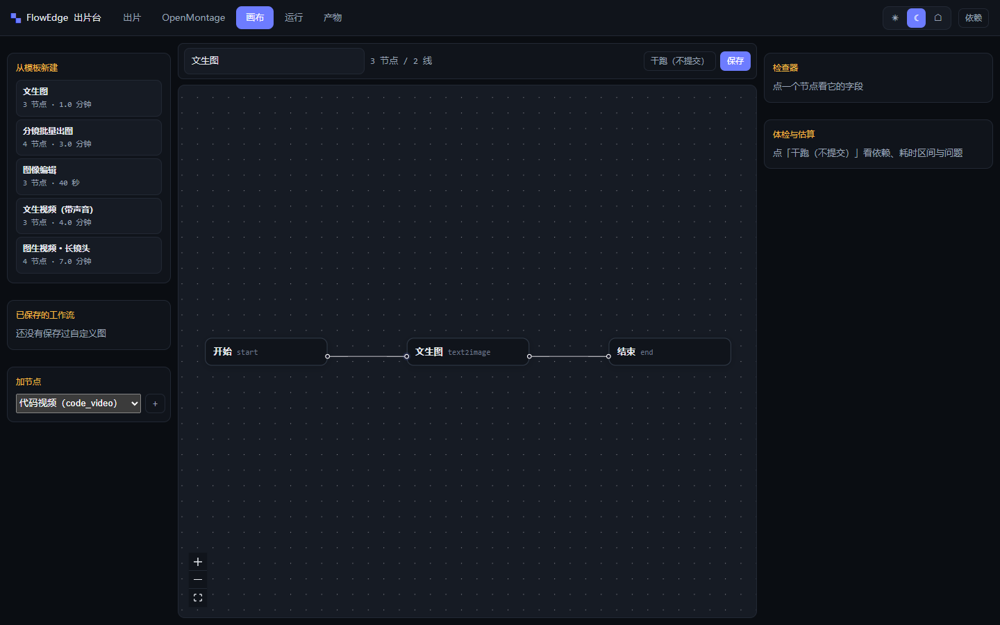
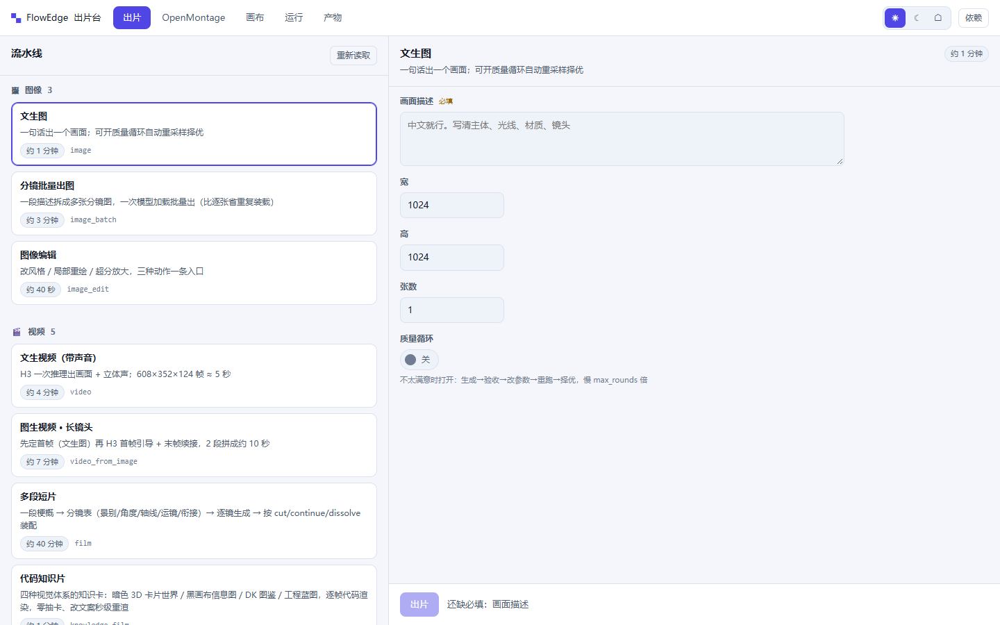

# FlowEdge

Local video and image production on one GPU. You pick a pipeline, fill in a form, and the engine
figures out what to load, what to free, and whether the result is any good. There is a canvas view
too if you'd rather wire the graph yourself. Everything runs on your machine; nothing is uploaded.

It builds into one Windows exe. No Docker, no Python, no Node on the target machine.


That clip (dialogue, ambience, lip movement) came out of a single RTX 3090 through a FlowEdge
pipeline. MiniMax-H3 did the video and the stereo audio in one pass.

## What it looks like



Left: the pipelines you can run. Right: the fields that pipeline needs. Nothing else to learn.



The canvas is the same engine with the lid off. Start from a template, drag nodes, run a dry-run
before you commit.



Light theme is its own palette, not a filter over the dark one.

## Why I built it

I had ComfyUI, Ollama, ffmpeg and a few TTS servers on one 24 GB card. Each worked alone. Together
they fought over VRAM, and the failures looked like "the node is broken" instead of "we ran out of
graphics memory twenty minutes ago".

Three things came out of that, all measured on this machine:

**VRAM arbitration.** A diffusion model (17 GB), an LLM (9 GB) and Whisper (3 GB) don't fit at
once. The engine evicts before it loads, waits for the device to actually free memory, and keeps the
queues separate so a CPU-only job doesn't wait behind a video render. A text-to-image plus vision
pipeline peaks at 15.0 GB with a 3D editor open, down from 24.0 GB.

**Consistency you can check.** Multi-shot clips drift. Shot three quietly becomes a different room
while the duration and the audio stay perfect. FlowEdge compiles the scene facts into one lock
sentence, injects it byte-for-byte into every shot, and fails the run if any shot's copy differs.

**Gates that run before delivery.** A 0.04 s crossfade once dropped an entire shot while every
timestamp looked fine. So the checks live inside the run: frame-exact counting, A/V drift, silence
gaps, loudness, speech verification. A take where the actor says the line twice gets rejected and
retried, not shipped.

## Interop

Two ways in, no connector catalogue:

- **MCP server.** `FlowEdge.exe --mcp` speaks stdio JSON-RPC. Agents get `flowedge_pipelines`,
  `flowedge_produce`, `flowedge_run_status`, `flowedge_runs`, `flowedge_artifacts`.
- **ComfyUI escape hatch.** The `comfy` node runs an Export (API) graph as-is. Anything ComfyUI can
  do is reachable without waiting for me to add a node. UI-format graphs are rejected with an
  explanation; converting them silently would produce a graph that looks runnable and is wired wrong.

## Before you commit to a run

`POST /api/preflight` and `POST /api/graph/dry-run` answer with a range instead of a guess:

```
peak 21.8 GB (range 18.5–25.1), wall 26–41 min, confidence medium (5 samples)
```

VRAM peaks are sampled per heavy node and accumulated in `data/vram_profiles.json`. No
extrapolation across parameter ranges, confidence drops below three samples, and estimates that came
from model size rather than a real run are marked as such. `fits` is judged on the upper bound.

## Configuration

| File | What it controls |
|---|---|
| `data/pipelines.json` | The 11 fixed pipelines: fields, where each field binds, which node gets skipped. Shipped in the repo, because it is the product. |
| `data/models.json` | Role → weight file, default steps/cfg/size, precision ladder. Generated on first run. |
| `data/deps.json` | How ComfyUI, Ollama, ffmpeg and the speech services are started, on which port, with how much VRAM held back. |

Weight names used to be hardcoded in eight places. Swapping a checkpoint meant editing Go and
rebuilding, and on any other machine the first run died with a ComfyUI validation error.

## What's in the box

11 pipelines: text to image, storyboard batch, image edit, text to video with audio, image to video
with a hand-off between segments, multi-shot films, code-rendered knowledge films, storyboard first
then shoot, voice-over, and plain text.

15 node types: `start`, `end`, `quality_loop`, `llm`, `storyboard`, `shotlist`, `text2image`,
`image2image`, `inpaint`, `upscale`, `text2video`, `tts`, `music`, `code_video`, `comfy`.

Films get subtitles (SRT written always, burned in on request), room tone under the seams, loudness
normalisation and a limiter. Code films render through headless Chromium and cost seconds instead of
minutes, so they queue on the CPU track while a video samples on the GPU.

## Running it

**Windows, no toolchain.** Grab `FlowEdge.exe` and `data/pipelines.json` from Releases, put them in a
folder, double-click. It opens `http://127.0.0.1:8080`. The engine starts without any backend
installed; the Environment panel tells you what's missing and how to start it.

**From source.**

```bash
cd backend && go run main.go          # Go 1.25+
cd frontend && npm install && npm run dev
```

**Build the exe.**

```bash
python scripts/build-windows.py --version 2026.11.11
```

**Linux/macOS.** `./scripts/run-local.sh` builds if needed, starts the engine and waits for health.

## Tests

```bash
python scripts/check-all.py --full     # build, go test, tsc, frontend tests
python scripts/release-check.py        # boots dist/FlowEdge.exe and asserts 20 things
python scripts/privacy-scan.py         # no usernames, emails, logs or internal notes in the tree
```

500+ backend tests, 60+ frontend tests. The pipeline format has contract tests, so a field that is
accepted by the API but never reaches a node fails the build instead of failing silently in
production.

## Security

Loopback only by default. Exposing it to the LAN requires `FLOWEDGE_HOST` plus
`FLOWEDGE_API_TOKEN`, otherwise it refuses to start. No telemetry, no account, no cloud. It is a
single-user tool: no roles, no encryption at rest, no sandbox for the workflows you load. See
[SECURITY.md](SECURITY.md) for what counts as a vulnerability here.

## Docs

- [Producing films](docs/多模态出片手册.md): choosing a pipeline, parameters, acceptance checks
- [Pipelines and canvas](docs/画布与流水线统一-20261029.md): how the two views share one engine
- [Prompt rules for product shots](docs/3D爆炸图提示词规范.md) and [video prompt structure](docs/视频提示词编排规范.md)
- [Release checklist](RELEASE.md) if you are cutting a build

## Stack

Go 1.25, Gin, GORM, gorilla/websocket. React 18, TypeScript, @xyflow/react, Tailwind. SQLite by
default, Postgres if you point it at one. Talks to Ollama, ComfyUI, ffmpeg, Whisper and Kokoro.

## License

Apache-2.0.
