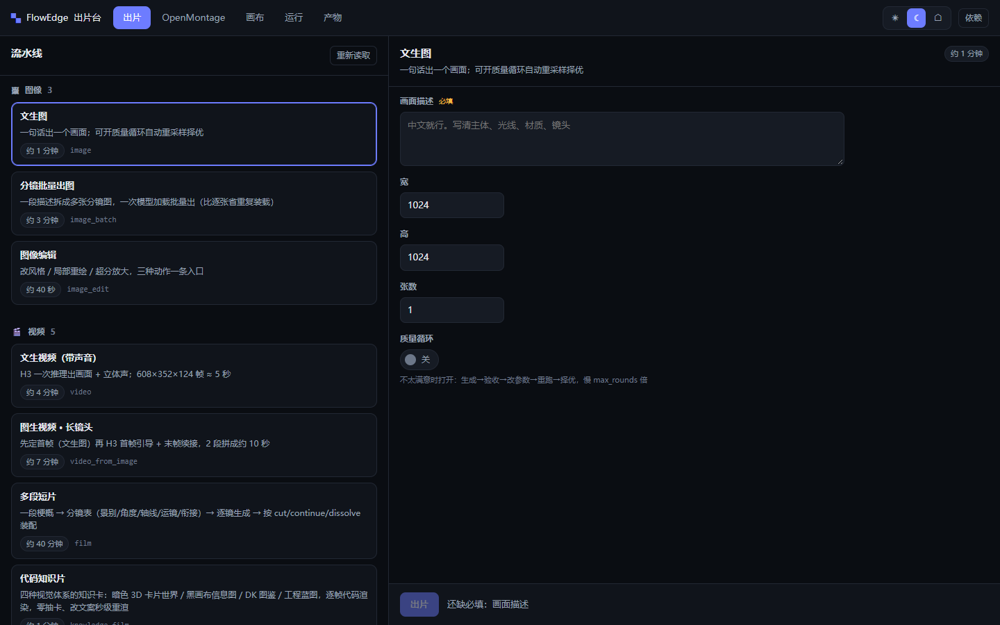
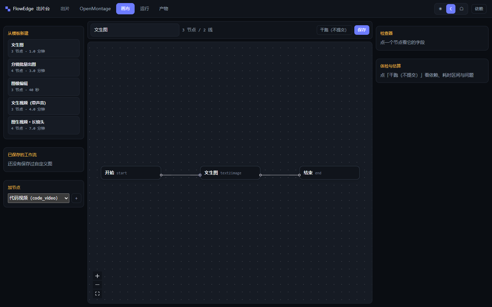

# FlowEdge 中文说明

一台显卡上做视频和图片。选一条流水线，把表单填了，引擎自己决定加载什么、腾什么、成品够不够格。
也可以开画布，自己连节点。全部跑在本机，不联网。

打完是一个 Windows exe。目标机器不用装 Docker、Python、Node。



## 长什么样

左边是能跑的流水线，右边是这条流水线要填的字段，没有别的东西要学。



画布是同一套引擎的另一面。从模板起步，拖节点，提交前可以先干跑一次看体检结论。

## 为什么做它

我一张 24G 卡上同时装着 ComfyUI、Ollama、ffmpeg 和几个 TTS 服务。单独用都正常，一起用就抢显存，
报出来的错还像「节点坏了」，其实是二十分钟前就没显存了。

三件事是这么被逼出来的，数字都是这台机器上量的：

**显存仲裁。** 扩散模型 17G、LLM 9G、Whisper 3G，塞不下。引擎在加载前先卸，等显存真回来，
再往下走；CPU 任务和 GPU 任务分开排队，不让一段代码渲染排在视频后面。图文 + 视觉理解这条链路，
开着 3D 编辑器的时候峰值 15.0G，之前是 24.0G。

**一致性可以验。** 多镜片子会漂，第三镜悄悄换了个房间，而时长和音轨全都正常。FlowEdge 把场景事实
压成一句锁句，逐镜字节一致地塞进提示词，任何一镜对不上就判这一轮失败。

**门开在交付之前。** 有次 0.04 秒的淡化比一帧还短，直接吃掉整段画面，而所有时间戳看着都对。
所以这些检查搬进了运行里：精确帧数、音画偏差、静音缺口、响度、台词验证。同一句台词念了两遍的
那一条会被打回重跑，不会交付。

## 怎么接别的工具

只有两个口子，不做连接器市场：

- MCP。`FlowEdge.exe --mcp` 走 stdio JSON-RPC，对外五个工具：列流水线、提交出片、查状态、
  列运行、取产物。
- ComfyUI 逃生舱。`comfy` 节点直接跑 Export (API) 出来的图，ComfyUI 能干的事不用等我加节点。
  UI 格式的图会被拒绝并说明原因，硬转会得到一张看着能跑、其实接错的图。

## 提交之前先看预算

`POST /api/preflight` 和 `POST /api/graph/dry-run` 给的是区间，不是一个数：

```
峰值 21.8G（区间 18.5–25.1），耗时 26–41 分钟，置信度 中（5 个样本）
```

每个重节点跑的时候采一次显存峰值，攒进 `data/vram_profiles.json`。不跨参数外推，样本少于三个
置信度降级，按模型体积估出来的会标出来。够不够，按上界算。

## 配置文件

| 文件 | 管什么 |
|---|---|
| `data/pipelines.json` | 11 条固定流水线：字段、绑到哪个节点、什么时候跳过。跟着仓库走，因为它就是产品本身。 |
| `data/models.json` | 角色 → 权重文件、默认步数/尺寸、精度阶梯。第一次启动时生成。 |
| `data/deps.json` | ComfyUI、Ollama、ffmpeg、语音服务怎么起，哪个端口，留多少显存。 |

这些权重名以前硬编码在八个地方，换一个 checkpoint 要改 Go 再重编；换台机器第一次跑就报
ComfyUI 的校验错误。

## 里面有什么

11 条流水线：文生图、分镜批量、图像编辑、带声音的文生视频、图生视频长镜头、多段短片、
代码知识片、先出分镜再拍、文案转配音、纯文本。

15 种节点：`start`、`end`、`quality_loop`、`llm`、`storyboard`、`shotlist`、`text2image`、
`image2image`、`inpaint`、`upscale`、`text2video`、`tts`、`music`、`code_video`、`comfy`。

片子会自动出 SRT 字幕，可选烧录；接缝下面铺一层底噪，避免听感上的断档；响度归一之后过一道限制器。
代码知识片走 headless Chromium，几秒出片，排 CPU 队列，不跟视频抢显卡。

## 怎么跑

Windows 最简单：从 Releases 下载 `FlowEdge.exe` 和 `data/pipelines.json`，放一个目录里，双击。
浏览器打开 `http://127.0.0.1:8080`。一个后端都没装也能起，环境面板会告诉你缺什么、怎么补。

从源码跑：

```bash
cd backend && go run main.go        # Go 1.25+
cd frontend && npm install && npm run dev
```

打 exe：

```bash
python scripts/build-windows.py --version 2026.11.11
```

Linux / macOS 用 `./scripts/run-local.sh`，会自动构建、起服务、等健康检查。

## 自检

```bash
python scripts/check-all.py --full     # 编译、go test、tsc、前端用例
python scripts/release-check.py        # 真起一次 exe，断言 20 项
python scripts/privacy-scan.py         # 仓库里没有用户名、邮箱、日志、内部笔记
```

后端 500 多个测试，前端 60 多个。流水线格式有契约测试，字段被 API 接受却到不了节点这种错，
构建时就红，不用等线上。

## 安全

默认只听回环。要开到局域网，得同时给 `FLOWEDGE_HOST` 和 `FLOWEDGE_API_TOKEN`，否则拒绝启动。
没有遥测，没有账号，不上传。单用户工具，没有角色权限，没有静态加密，加载别人的 workflow 包
就是执行别人的图。细节和「什么不算漏洞」看 [SECURITY.md](../../SECURITY.md)。

## 文档

- [多模态出片手册](../多模态出片手册.md)：选路、参数、验收、排错
- [画布与流水线统一](../画布与流水线统一-20261029.md)：两个视图怎么共用一个引擎
- [3D 爆炸图提示词规范](../3D爆炸图提示词规范.md)、[视频提示词编排规范](../视频提示词编排规范.md)
- [发版步骤](../../RELEASE.md)

## 技术栈

Go 1.25、Gin、GORM、gorilla/websocket；React 18、TypeScript、@xyflow/react、Tailwind；
SQLite（也能接 Postgres）；对 Ollama、ComfyUI、ffmpeg、Whisper、Kokoro 说话。

## 许可

Apache-2.0。
