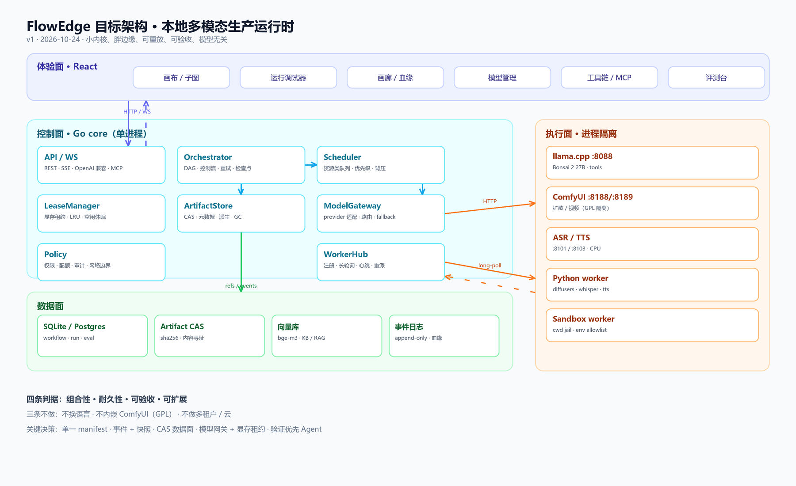

# FlowEdge 本地超级工作流平台 · 架构设计 v1

> 日期：2026-10-24 ｜ 依据：本仓库源码实查 + 运行实例实测 + GitHub 开源项目调研（star 采样于 2026-10-24）
> 结论先行：**FlowEdge 不该变成「更大的 ComfyUI」或「本地的 Dify」，而应成为「本地多模态生产运行时」：小内核、胖边缘、可重放、可验收、模型无关。**

---

## 0. 一页结论

### 0.1 「超级工作流平台」的四个判据

| # | 判据 | 含义 | 不满足时的症状 |
|---|---|---|---|
| 1 | **组合性** | 任何模态、任何模型都能作为节点接入；控制流（分支/循环/子图/扇出）完整 | 加一个模型要改引擎、重编译 |
| 2 | **耐久性** | 任何长任务可中断、恢复、重放、审计；崩溃不丢进度 | 跑到 80% 崩了只能从头再来 |
| 3 | **可验收** | 产物有确定性判据（测试/ffprobe/哈希/契约），不靠模型自评 | 「模型说完成了」但产物是坏的 |
| 4 | **可扩展** | 加节点/加模型/加 worker 不改内核、不重编译 | 社区无法贡献，生态起不来 |

### 0.2 五条架构主线

| 主线 | 一句话 | 现状 |
|---|---|---|
| **单一节点契约** | 一份 manifest 同时生成执行注册表、UI 表单、任务书、构图目录、文档 | ❌ 两套注册表（`nodespec.go` + `nodecontract.go`）+ 多处 switch |
| **运行事件化** | Run 是事件流 + 快照，不是一段内存状态；可重放、可恢复 | ⚠️ 有事件表，但恢复靠整份 `node_states` 快照 |
| **数据面 CAS** | 端口传内容寻址的 ArtifactRef，不传裸文件路径；天然去重/血缘/缓存 | ❌ `data/generated` 平铺文件，血缘按文件名 |
| **模型网关 + 显存租约** | 所有模型（LLM/扩散/ASR/TTS）经统一网关；显存是租约不是布尔值 | ⚠️ 有 GPU 调度器，但只管部分后端；外部进程（Bonsai/ComfyUI）没有租约 |
| **验证优先 Agent** | Agent 只提议，门做裁决；工具带权限，执行在沙箱 | ⚠️ 有工具循环，但只有 4 个内置工具，MCP 工具进不来 |

### 0.3 三条明确不做

1. **不换语言、不引入 Python 核心**：Go 单 exe 是核心卖点；Python 只以 worker 形式存在。
2. **不内嵌 ComfyUI 代码**：GPL-3.0 有传染性；只借协议（`/prompt`、`/object_info`、`/queue`），进程隔离。
3. **不做多租户 / RBAC / 云计费**：本地单人/小团队场景，做了只会拖慢内核。

### 0.4 现状 → 目标差距

| 维度 | 现在 | 目标 | 优先级 |
|---|---|---|---|
| 节点契约 | 两套注册表 + 9 处派生 switch | 一份 manifest，编译期生成全部视图 | P0 |
| 运行恢复 | 整份快照，事件不参与重放 | 事件日志 + 快照 + CAS 引用 | P0 |
| 产物 | 平铺文件名，靠命名约定 | SHA-256 CAS + 元数据 + 血缘边 | P0 |
| 模型控制 | 只认 OpenAI 兼容；无 temp/max_tokens/超时/取消 | 统一网关 + provider 适配 + 租约 | P0 |
| 队列 | 进程内信号量，默认并发 2 | 资源类队列 + worker 拉取 + 优先级 | P1 |
| 工具面 | 4 个内置工具；MCP 工具不可被模型调用 | 工具注册表 + MCP 桥 + 工作流即工具 | P1 |
| Agent | 节点内 4–12 轮工具循环 | 可检查点、可中断、可验证的 Agent 运行时 | P2 |
| 评测 | 有 evidence/evolution，缺任务级回归 | 数据集 + grader + 配对 A/B + 回归门 | P2 |
| 前端 | `App.tsx` 75KB、`NodeInspector.tsx` 112KB | 模块化 + schema 驱动表单 + 运行调试器 | P2 |

### 0.5 12 周路线（假设 1 名主程 + 2 个 agent）

| 阶段 | 周期 | 交付 | 验收 |
|---|---|---|---|
| **P0 契约与数据面** | 2 周 | Manifest v2 + CAS 双写 + 事件 schema v2 + 模型控制补丁 | 加节点只改 1 份 manifest；旧工作流全绿 |
| **P1 队列与 Worker** | 4 周 | 资源类队列 + worker 协议 + Python worker + 模型网关/租约 | kill -9 后恢复；换模型不 OOM |
| **P2 Agent 与评测** | 4 周 | agent 节点 + 工具/沙箱 + 评测台 | 20 任务集通过率达标；测试篡改 0 |
| **P3 生态** | 持续 | 节点市场 + 模板 + 分布式 worker | 第三方节点可安装/卸载 |

---

## 1. 现状审计（只列有代码证据的）

### 1.1 已经对的六件事（不要重造）

| # | 事实 | 证据 | 为什么值钱 |
|---|---|---|---|
| 1 | 单二进制 + 内嵌前端 + SQLite | `backend/main.go`、`backend/web`、`main.go:862` | 免安装分发是差异化 |
| 2 | DAG 执行器有完整控制流 | `engine_v2.go:608`：层调度、`skipBFS`、`join any/all`、`if_else` 路由、`loop` until/foreach | 不需要引入 Airflow/Temporal |
| 3 | 节点契约已经声明化 | `nodecontract.go:107`：Title/Role/Inputs/Outputs/KeyParams/Requires/GateLayers/Agent/Nondeterministic | 已有「单一契约」的雏形 |
| 4 | 运行控制完整 | `run_control.go` + `handler/debug.go`：pause/step/resume/rerun-from/cancel；`shots/:index/reroll` | 长任务调试体验是稀缺能力 |
| 5 | 验收门有牙齿 | `quality_gate.go`（ffprobe/响度/静音缺口）、`consistency_gate`、`verify-media.py` | 这是「不会说谎」的根 |
| 6 | 事件与证据体系 | `event_log.go`（批量落库）、`evidence.go`、`evolution*` | 评测与自进化的底座 |

### 1.2 结构债（按杠杆排序）

| # | 债 | 证据（file:line） | 后果 | 处理 |
|---|---|---|---|---|
| **D1** | **两套节点注册表** | `nodespec.go:24`（Side/Heavy/Media/Timeout） vs `nodecontract.go:107`（Ports/Params/Gates） | 加节点要同时改两处，且 UI/任务书/预检/构图各读一份 | Manifest v2 统一，生成两个视图 |
| **D2** | **派生逻辑仍是 switch** | `engine_v2.go:259`（侧别）、`nodespec.go:164`（超时）、`node_cache.go:42`（可缓存白名单）、`lineage.go:61`（血缘 kind） | 新节点漏改 = 静默降级（不缓存/不记血缘/不采样显存） | 字段进 manifest，删除 switch |
| **D3** | **运行恢复是整份快照** | `engine_v2.go:643` 起用 `prev []NodeInstance` 回填；`event_log.go` 只做 trace 不做 replay | 快照与事件双写，状态可能不一致；无法从事件重建 | 事件为源 + 周期快照；恢复读投影 |
| **D4** | **数据面是平铺文件** | `handler/artifact.go:16`（`data/generated`）；`lineage.go:21`（按文件名） | 同名覆盖、无法去重、跨机器不可迁移、缓存键不稳 | CAS + ArtifactRef + 元数据表 |
| **D5** | **队列只是信号量** | `queue.go:17`：`sem chan struct{}`，默认并发 2（`main.go:395`） | 无优先级、无资源类、无 worker、无公平性 | Scheduler + 资源类 + worker |
| **D6** | **模型控制面缺失** | `llm.go:61` 无 `max_tokens`；`llm.go:50` 客户端 120s；`engine_v2_nodes.go:37` 无 temperature | 输出不可复现、长任务被砍、思考预算不可控 | 网关统一请求 schema |
| **D7** | **工具面太窄** | `tools.go:42` 仅 4 个内置；MCP 工具未进 `ToolSpec` | 模型只能「空想」，复杂工程做不动 | ToolRegistry + MCP 桥 + 工作流即工具 |
| **D8** | **插件没有契约** | `plugin_loader.go:42` 只有 name/type/url/side | 插件节点没有端口/参数/门，UI 只能给通用 JSON 框 | Manifest v2 覆盖插件 |
| **D9** | **前端上帝文件** | `App.tsx` 74,949B、`NodeInspector.tsx` 112,223B | 改一处要读三千行；零测试安全网薄 | 模块化 + schema 表单 |

### 1.3 判断

**引擎不弱，缺的是三样：契约单源、数据面、执行耐久性。** 这三样补上，现有的门、证据、断点、显存调度才会从「单机手工能力」变成「平台能力」。

---

## 2. 开源对标（GitHub 实查）

> star 数为 2026-10-24 采样（ungh.cc / shields.io）；标「未核实」的是本轮没取到 LICENSE 原文。

### 2.1 矩阵

| 项目 | Star | License | 该借什么 | 不该借什么 |
|---|---|---|---|---|
| [Temporal](https://github.com/temporalio/temporal) | 23,946 | MIT | **事件历史 + 重放续跑**、worker 主动拉取、Worker Versioning、Child Workflow | 三服务 + Cassandra/ES；强确定性重放（LLM/GPU 做不到） |
| [Windmill](https://github.com/windmill-labs/windmill) | 18,249 | 未核实 | YAML 定义 flow、脚本版本化 + lockfile、单步重跑、并发限流 | 每语言一个 runtime 镜像 |
| [Hatchet](https://github.com/hatchet-dev/hatchet) | 8,172 | MIT | **Embedded/Lite 单进程形态**、sticky assignment、task eviction 重派、slot 并发 | gRPC + Postgres + RabbitMQ 控制面 |
| [n8n](https://github.com/n8n-io/n8n) | 208,375 | fair-code（非 OSI，未核实） | **节点契约驱动 UI**、sub-workflow、触发器分类、逐节点执行历史 | 400+ 集成体量、Redis 队列模式 |
| [Dify](https://github.com/langgenius/dify) | 159,296 | 未核实 | DSL 导出/导入（可 diff/版本化）、变量选择器、单步重跑 | Celery + 向量库部署栈 |
| [Langflow](https://github.com/langflow-ai/langflow) | 155,949 | MIT | **类型化端口**、画布由后端 schema 生成、图 JSON 可移植 | Python 作核心 |
| [Node-RED](https://github.com/node-red/node-red) | 23,775 | Apache-2.0 | msg 单对象传递、subflow 端口映射、context 分层 | 全动态 JS 运行时 |
| [ComfyUI](https://github.com/Comfy-Org/ComfyUI) | 142,333 | GPL-3.0 | **`/object_info` 自描述 + 提交前 `node_errors`**、`execution_cached` 事件、`/queue` 可中断、部分图重执行 | 内嵌其代码（GPL 传染）、节点 id 隐式约定 |
| [LangGraph](https://github.com/langchain-ai/langgraph) | 未取 | MIT | checkpoint / interrupt / resume / 短期记忆 | LangChain、LangSmith 依赖 |
| [OpenHands](https://github.com/OpenHands/OpenHands) | 未取 | MIT | agent 与执行器分离、容器即权限边界 | 多仓库拆分、云后端 |
| [SWE-agent](https://github.com/SWE-agent/SWE-agent) | 未取 | MIT | **ACI 四条反馈**（专用查看器、编辑前 lint、空输出显式回执、搜索只列名）+ 轨迹落盘 | SWE-ReX 远程栈 |
| [Aider](https://github.com/Aider-AI/aider) | 未取 | Apache-2.0 | **repo map 符号图 + token 预算裁剪**、SEARCH/REPLACE 唯一匹配校验 | 模型适配表、自动 commit |
| [OpenCode](https://github.com/sst/opencode) | 未取 | MIT | **plan 只读 / build 可写**、工具权限分级 | Bun/TS 运行时 |
| [MCP servers](https://github.com/modelcontextprotocol/servers) | 未取 | Apache-2.0 / MIT | 工具协议、filesystem 最小权限边界 | 整包依赖（README 自述非生产） |
| [E2B](https://github.com/e2b-dev/E2B) | 未取 | Apache-2.0 | 沙箱 API 形状（create/exec/timeout/destroy） | 云 + Terraform |
| [Langfuse](https://github.com/langfuse/langfuse) | 未取 | MIT（ee 除外） | trace→span→generation 数据模型、dataset/experiment | ClickHouse/Postgres 全家桶 |
| [Phoenix](https://github.com/Arize-ai/phoenix) | 未取 | Elastic License 2.0 | **OpenTelemetry/OpenInference 语义约定** | ELv2 代码与重型服务 |
| [promptfoo](https://github.com/promptfoo/promptfoo) | 未取 | MIT | 声明式断言 + CI 门禁最小形态 | red-team 全家桶 |
| [Inspect AI](https://github.com/UKGovernmentBEIS/inspect_ai) | 未取 | MIT | 数据集/交互/打分的评测分层 | Python 框架耦合 |
| [Ollama](https://github.com/ollama/ollama) | 未取 | MIT | `keep_alive` 租约、`/api/ps` 显存账本、digest 校验、断点续传 | blobs 全局模型库（与 `D://AI//Models` 冲突） |
| [llama.cpp](https://github.com/ggml-org/llama.cpp) | 未取 | MIT | slot 并发、`--fit` 按显存自调、`--sleep-idle-seconds`、`/lora-adapters` | 单进程单模型（换模型要重启） |
| [vLLM](https://github.com/vllm-project/vllm) | 未取 | Apache-2.0 | PagedAttention 的「分页即租约」思想、prefix caching、multi-LoRA | 启动预分配整卡 KV 池 |
| [SGLang](https://github.com/sgl-project/sglang) | 未取 | Apache-2.0 | RadixAttention 前缀复用（细节未核实） | 吞吐优先的批处理策略 |
| [LiteLLM](https://github.com/BerriAI/litellm) | 未取 | MIT | 统一 OpenAI 兼容网关、别名映射、fallback/重试 | 云端计费耦合 |

### 2.2 五条最值得抄的设计

1. **事件历史 + 重放**（Temporal）：续跑只记「命令与结果」，不存「内存状态」。
2. **`object_info` 式自描述 + 提交前 `node_errors`**（ComfyUI）：前端与执行器共享单一契约源，正好接上 FlowEdge 现有的契约测试。
3. **Embedded/Lite 单进程形态**（Hatchet）：集群能力可选，本地默认零依赖。
4. **节点契约驱动 UI + 逐节点执行历史**（n8n）：节点作者只写契约，不写表单。
5. **repo map + ACI 反馈**（Aider/SWE-agent）：上下文按符号预算裁剪；工具输出必须「可行动」（错误原文、行号、空结果显式说明）。

### 2.3 明确不抄

- **不抄 Dify/Langflow 的 Python 单体**：依赖重、启动慢、与单 exe 冲突。
- **不抄 n8n 的 400+ 集成**：集成应通过 HTTP/MCP/worker 生态获得，不进内核。
- **不抄 Temporal 的强确定性重放**：LLM/GPU 节点不可确定性重放，只重放编排决策。
- **不抄 ComfyUI 的代码**：GPL-3.0，只学协议。
- **不抄 Phoenix 的代码**：ELv2，只借 OTel 语义。

### 2.4 差异化位置（为什么这件事值得做）

| 对手 | 它强在哪 | 它缺什么 | FlowEdge 的差异 |
|---|---|---|---|
| ComfyUI | 扩散节点生态、模型管理、社区工作流 | 无门、无耐久执行、无跨进程显存仲裁、无 LLM/代码编排 | 把 ComfyUI 当 provider，外面加编排 + 验收 + 租约 |
| n8n / Dify | 集成数量、LLM 应用编排、RAG | 不懂本地 GPU、不懂媒体产物、没有数值门 | 同样的画布体验，但产物可验收、显存可治理 |
| Temporal / Hatchet | 耐久执行、队列、重试 | 不懂模型、不懂媒体、部署重 | 借事件历史/队列思想，但单机零依赖 |
| LangGraph / OpenHands | Agent 自主性、工具生态 | 无确定性验收、无 GPU 调度、轨迹不可复现 | Agent 只提议，门做裁决；执行有租约与沙箱 |

**一句话**：市面上没有第二个系统同时做到「按图执行 + 多模态模型 + 数值门 + 显存租约 + 单机零依赖」。这就是「超级」的定义——不是功能最多，而是这五项同时成立。

---

## 3. 目标架构

### 3.1 三平面



```
┌────────────────────────────────────────────────────────────────────┐
│  体验面 (React)                                                     │
│  画布 / 运行调试器 / 画廊 / 模型管理 / 工具链 / 评测台 / 设置          │
├────────────────────────────────────────────────────────────────────┤
│  控制面 (Go core, 单进程)                                            │
│  API(REST/WS/OpenAI/MCP/Webhook) │ 编排器 │ 调度器 │ 租约 │ 策略      │
├────────────────────────────────────────────────────────────────────┤
│  数据面                                                             │
│  Artifact CAS (fs) │ SQLite/Postgres │ 向量库 │ 事件日志 │ 血缘       │
├────────────────────────────────────────────────────────────────────┤
│  执行面 (进程隔离)                                                   │
│  Go 内置节点 │ Python worker │ ComfyUI │ llama.cpp │ ASR/TTS │ 沙箱    │
└────────────────────────────────────────────────────────────────────┘
```

**核心原则：内核只懂契约、队列、数据、事件；能力全部在节点/worker/provider 里。**

### 3.2 进程拓扑

```
Browser ──HTTP/WS──┐
                   ▼
        ┌─────────────────────┐
        │ FlowEdge Core (Go)   │
        │ :8080                │
        │  ├ API/WS            │
        │  ├ Orchestrator      │
        │  ├ Scheduler/Queue   │
        │  ├ LeaseManager      │
        │  ├ ModelGateway ─────┼──HTTP──► llama.cpp :8088
        │  ├ ArtifactStore     │           Ollama :11434
        │  └ WorkerHub ────────┼──HTTP──► ComfyUI :8188/:8189
        └─────────┬───────────┘           ASR :8101 / TTS :8103
                  │ long-poll
                  ▼
        ┌─────────────────────┐
        │ flowedge-worker-py  │  diffusion / embeddings / whisper / tts
        │ (可选，多实例)       │  cwd jail / env allowlist / timeout
        └─────────────────────┘
```

- **默认单机单进程**：不装 worker 也能跑全部内置节点。
- **需要 Python 生态时**才起 worker；worker 可多实例、可跨机器。
- **ComfyUI 永远进程隔离**：GPL + 依赖互斥。

### 3.3 组件职责

| 组件 | 职责 | 不负责 |
|---|---|---|
| API | 鉴权、DTO、SSE/WS、OpenAI/MCP 兼容、webhook | 业务编排 |
| Orchestrator | DAG 解析、控制流、重试、超时、取消、检查点 | 模型调用细节 |
| Scheduler | 资源类队列、优先级、公平性、背压 | 显存具体分配 |
| LeaseManager | 显存/模型租约、LRU 驱逐、空闲休眠、OOM 重试 | 推理 |
| ModelGateway | provider 适配、路由、fallback、usage 统计 | 图编排 |
| ArtifactStore | CAS 写入/读取、元数据、派生图、GC | 业务语义 |
| WorkerHub | 注册、长轮询派单、心跳、结果回收、失联重派 | 执行 |
| Policy | 权限、配额、网络/文件边界、审计 | 性能优化 |

### 3.4 一次运行的完整路径

1. `POST /api/workflows/:id/run` → 校验图 + 预检（**有 profile 就不要求 Ollama**）→ 创建 `run`（钉住 workflow_version + eval 元数据）。
2. Orchestrator 生成第一层可执行节点；每个节点生成 `attempt`（幂等键 = run 输入 + 节点配置 + 上游 ArtifactRef + 策略）。
3. Scheduler 按资源类派单：内置节点直接执行；worker 节点入队等 worker 拉取。
4. 节点执行前 `LeaseManager.Acquire(model, vram, ttl)`；不足则排队/驱逐/失败（显式错误，不静默）。
5. 节点输出写入 CAS，得到 `ArtifactRef`；事件 `node_finished` 落库（含 outputs、metrics、usage）。
6. 门节点读产物 + 计划，给出 `gate_result`；失败 → 分支/重试/升级。
7. 全部完成 → `run_finished`；血缘按 ref 写边；证据信封落盘；缓存按内容哈希可复用。
8. 崩溃恢复：读事件流 + 快照 → 已完成节点从 CAS 复用 → 未完成节点重新入队；外部异步任务按 job id 续轮询。

---

## 4. 核心设计

### 4.1 运行模型：Run / Attempt / Event / Snapshot

**四件套**：

| 对象 | 定义 | 存储 |
|---|---|---|
| `Run` | 一次工作流执行，绑定不可变图版本 + 输入 + 评测元数据 | `workflow_runs` |
| `NodeAttempt` | 某节点的一次尝试；含输入 refs、参数哈希、状态、指标 | `node_attempts` |
| `RunEvent` | 追加写事件；`seq` 单调；含 `schema_version`、`trace_id`、`attempt` | `run_events` |
| `RunSnapshot` | 每 N 个事件或每层结束时的状态投影 | `run_snapshots` |

**幂等键**：

```
attempt_key = sha256(
  run_input_hash,
  node_id + node_config_hash,
  sorted(upstream_artifact_refs),
  attempt_policy_version
)
```

同一 key 已有成功结果 → 直接复用（缓存命中记 `cache_hit=true` 事件），不再调用模型。**只有 `deterministic: true` 或显式 `cache: true` 的节点才允许复用**；LLM/扩散这类随机节点必须重算，否则评测会被「假缓存」污染。这比现在的 `cacheKey(type,data,upstream)` 更稳：**上游用内容哈希，不用内存对象**。

**事件 schema（v2）**：

```json
{
  "schema_version": 2,
  "seq": 42,
  "run_id": 123,
  "node_id": "n3",
  "attempt": 1,
  "type": "node_finished",
  "ts": "2026-10-24T07:12:33.123+08:00",
  "trace_id": "5f2c...",
  "span_id": "a91b...",
  "data": {
    "status": "success",
    "outputs": {"image": "sha256:ab12..."},
    "metrics": {"duration_ms": 8421, "vram_peak_mb": 11200},
    "usage": {"prompt_tokens": 0, "completion_tokens": 0}
  }
}
```

**恢复语义**：

- 已完成节点：状态从快照 + 事件投影得到，输出从 CAS 取。
- 运行中节点：标记 `interrupted`，重启后按策略重跑或续轮询（外部 job）。
- 副作用节点（发布、上传、发消息）：必须声明 `idempotent: false` + `side_effect_key`；重跑前查外部状态，避免重复发送。
- 取消：context 透传到 provider（HTTP cancel / 断开连接），不只丢队列。

### 4.2 单一节点契约（Manifest v2）

**目标**：一份 YAML/JSON 同时生成 6 个视图——执行注册表、UI 表单、任务书、构图目录、文档、OpenAPI schema。

```yaml
apiVersion: flowedge.dev/v1
kind: Node
metadata:
  name: text2image
  version: 1.2.0
  title: 文生图
  category: image
spec:
  role: generator
  inputs:
    - {name: prompt, kind: text, required: true}
    - {name: ref, kind: image, required: false}
  outputs:
    - {name: image, kind: image}
  params:
    type: object
    properties:
      model: {type: string, enum: [auto, flux, moss], default: auto}
      width: {type: integer, default: 1024, minimum: 256, maximum: 2048}
      steps: {type: integer, default: 8, minimum: 1, maximum: 50}
    required: [prompt]
  resources:
    gpu: {vram_mb: 12000, class: diffusion}
    timeout: {default: 300s, max: 1800s}
  requirements:
    - provider: comfyui
  gates: [technical, identity]
  deterministic: false
  executor:
    type: builtin          # builtin | worker | http | wasm
  ui:
    icon: image
    color: "#7c3aed"
```

**编译产物**：

| 视图 | 消费方 | 生成方式 |
|---|---|---|
| 执行注册表 | 引擎 | `go:generate` 或启动时加载 |
| UI 表单 | NodeInspector | JSON Schema → 表单渲染器 |
| 任务书 | `/api/workflows/:id/spec` | 同现有 `spec.go`，数据源换 manifest |
| 构图目录 | `compose` | 每节点一行，自动裁剪 |
| 文档 | 节点面板 | manifest + 示例 |
| API schema | 前端/外部 | OpenAPI 片段 |

**兼容策略**：

- 内置节点：Go 结构体 + manifest 生成器，保持零运行时开销。
- 外部节点：manifest 文件放 `data/nodes/<name>/node.yaml`，启动时加载；可选 git 安装。
- 版本：`apiVersion` 主版本协商；节点 `version` 语义化；工作流可钉节点版本。
- 校验：`flowedge node lint`（端口/参数/依赖/门自洽）+ `flowedge node test`（fixture 回放）。

**这一条做完，D1/D2/D8 一起消失。**

### 4.3 数据面：CAS + 血缘

**目录布局**：

```
data/artifacts/
  sha256/ab/ab12...ef.png
  sha256/cd/cd34...gh.mp4
  derivatives/ab/ab12...ef.thumb.jpg
```

**Artifact 元数据表**：

| 字段 | 说明 |
|---|---|
| `id` | `sha256:...`（内容寻址） |
| `kind` | text/json/image/video/audio/embedding/model/patch/trace |
| `mime` / `size` | 类型与大小 |
| `meta` | width/height/duration/fps/sample_rate/channels |
| `created_by_run` / `node` | 来源 |
| `parents` | 上游 artifact ids（血缘边） |
| `pinned` | 被 run/evidence 引用则 pin，GC 不删 |

**端口值**：

```go
type Value struct {
    Kind   string      // text/json/image/video/audio
    Inline string      // 小文本（<4KB）
    Ref    string      // CAS id
    Meta   map[string]any
}
```

**收益**：

- 同一张图被两个节点引用 → 只存一份；缓存键稳定。
- 血缘从「文件名约定」变成「内容边」，跨机器可迁移。
- 删除/GC 有引用计数；导出运行包 = 事件 + 引用清单。

**迁移**：双写两周——新节点写 CAS，旧节点继续写 `data/generated`，画廊同时读两处；稳定后切读 CAS，旧文件按 pin 状态清理。

### 4.4 模型网关与显存租约

**Provider 接口**（所有后端一个形状）：

```go
type Provider interface {
    ID() string
    Capabilities() []Capability        // chat/tools/vision/image/video/asr/tts/embed
    Health(ctx) error
    Submit(ctx, Request) (JobID, error) // 同步 provider 立即返回结果
    Poll(ctx, JobID) (Result, error)
    Cancel(ctx, JobID) error
    Usage(JobID) (Usage, error)
}
```

**适配器**：

| 适配器 | 后端 | 备注 |
|---|---|---|
| `openai-compatible` | llama.cpp / Ollama / vLLM / LM Studio / 云 API | 现有 LLMService 扩展 |
| `ollama-native` | Ollama | keep_alive、/api/ps、卸载 |
| `comfyui` | ComfyUI 8188/8189 | `/prompt` + WS + `/queue`，进程隔离 |
| `worker` | Python worker | diffusion/whisper/tts/embedding |
| `onnx` | ONNX Runtime | 小模型/CPU |

**ComfyUI 的定位**：作为 `comfyui` provider，不进入内核。节点只传 workflow JSON + 参数绑定；启动时拉 `/object_info` 做契约校验（等价于 ComfyUI 的 `node_errors`）；用 `/queue` 取消、WS 事件推进度；模型路径继续走 `extra_model_paths.yaml`。**永远进程隔离（GPL-3.0），只学协议不链接代码。** ComfyUI workflow 可作为模板导入，但导入后要经过 FlowEdge 的 manifest 校验，不能直接执行。

**本地模型分工（24GB 单卡，建议）**：

| 角色 | 模型 | 常驻策略 | 说明 |
|---|---|---|---|
| 主脑（planner/implementer） | Bonsai 2 27B | GPU 常驻（租约） | 5.53GB 权重 + ~7GB KV，70–80 tok/s，工具调用已验证 |
| 复核（reviewer） | qwen2.5:14b 或 qwen3.8:27b | 14B 可尝试共存；27B 仅换载 | 不同错误模式；先测「捕获率 vs 换载成本」 |
| 视觉质检 | moondream | 小模型可常驻 | 截图/UI/画面描述；Bonsai 视觉 −5.2 分，不拿它做视觉验收 |
| 检索 | bge-m3 | CPU/小显存常驻 | KB/RAG embedding，必留 |
| 重载升级 | qwen3.8:27b | 按需换载 | 262K ctx、tools+thinking；只在里程碑任务用 |

**规则**：两个 27B 不可能同时驻留 24GB；「多模型联用」在单卡上是**时间上的角色切换**，不是空间上的并行。14B 能否与 Bonsai 共存要实测峰值，不能按算术赌。

**模型注册表**：

```json
{
  "id": "bonsai-2-27b",
  "provider": "llamacpp",
  "endpoint": "http://127.0.0.1:8088",
  "capabilities": ["chat", "tools", "vision"],
  "context": 32768,
  "vram_mb": 13000,
  "load_policy": "on_demand",
  "idle_ttl_sec": 300,
  "priority": 10
}
```

**租约**：

```
Acquire(model, need_mb, ttl, priority) -> LeaseID
Release(LeaseID)
```

- 账本 = 总显存 − 已租 − 安全余量（默认 2GB）。
- 不足时：驱逐 idle（LRU）→ 排队 → 超时失败（显式 `vram_exhausted`，不静默换小模型）。
- 空闲 TTL：到期释放；llama.cpp 用 `--sleep-idle-seconds`，Ollama 用 `keep_alive`，ComfyUI 用 `/free`。
- OOM 重试：降 context/降分辨率/换量化，**必须在事件里记录降级原因**。

**路由**：

```
capability → 候选模型 → 过滤（health/本地策略/租约可达）
          → 打分（质量档 × 成本 × 延迟）
          → 首选 + fallback 链
```

默认 `local_only=true`；任何云 provider 必须显式开启并记录到 run 元数据。

### 4.5 队列、Worker 与异步任务

**资源类**（不是按 CPU 核数）：

| 类 | 并发 | 典型节点 |
|---|---|---|
| `gpu.diffusion` | 1 | text2image / inpaint / upscale |
| `gpu.video` | 1 | text2video / shotlist |
| `gpu.llm` | 1–2（按租约） | llm / vision / agent |
| `cpu.audio` | 2–4 | asr / tts / post_production |
| `cpu.embed` | 4 | rag_query / embeddings |
| `io` | 8 | http_request / command |
| `sandbox` | 2 | agent tools / code |

**Worker 协议**（HTTP 长轮询，零依赖）：

| 端点 | 方向 | 作用 |
|---|---|---|
| `POST /api/workers/register` | worker→core | capabilities、并发、标签、版本 |
| `POST /api/workers/:id/lease?wait=30s` | worker→core | 领取 task；无任务则挂起 |
| `POST /api/workers/:id/tasks/:tid/heartbeat` | worker→core | 心跳 + 取取消信号 |
| `POST /api/workers/:id/tasks/:tid/complete` | worker→core | 输出 refs + metrics + logs |
| `POST /api/workers/:id/tasks/:tid/fail` | worker→core | 错误码 + 可重试标记 |

**Task envelope**：

```json
{
  "task_id": "t-9f2c",
  "run_id": 123,
  "node_id": "n3",
  "attempt": 1,
  "type": "text2video",
  "inputs": {"prompt": {"kind": "text", "inline": "..."}},
  "params": {"width": 608, "height": 352, "frames": 124},
  "resources": {"gpu": "diffusion", "vram_mb": 18000},
  "deadline": "2026-10-24T08:20:00+08:00",
  "cancel_token": "c-..."
}
```

**异步外部任务**（ComfyUI/视频 API/训练）：

- `Submit` 返回 `job_id`；引擎持久化 `external_jobs(run_id,node_id,job_id,provider,state,poll_after)`。
- 后台 poller 按 `poll_after` 轮询；崩溃重启后按表续轮询。
- Webhook 完成路径可选；轮询为兜底。
- 取消：调用 provider cancel + 标记 task cancelled；worker 失联按 `task_eviction` 重派（sticky 优先同一 worker）。

**恢复**：

- 进程启动 `RecoverInterrupted` 把 running → interrupted（现有逻辑保留），但**不再直接标 failed**：读快照 + 事件，已完成节点复用，未完成节点重新入队。
- Worker 失联：心跳超时 → 任务重派；副作用任务需 `idempotent` 声明。

### 4.6 多模态类型系统

**类型**：`text | json | image | video | audio | embedding | model | patch | any`。

**运行时校验**（现在只有设计时）：

- 连接时：`PortKindAccepts`（已有）。
- 执行前：按 manifest 的 `inputs[].kind` 校验 `Value.Kind`；不匹配 → `port_type_mismatch`，不进入执行。
- 输出后：按 `outputs[].kind` 校验；生成缩略图/波形/时长元数据。
- `any` 只允许显式声明，不允许默认透传。

**派生文件**：缩略图、contact sheet、波形、字幕、代理视频（低码率预览），异步生成，画廊只读元数据。

**跨模态约束**：视频节点必须带 `audio` 或显式 `silent: true`；TTS 必须带 `voice`；图像门必须能拿到 `width/height`。这些进 manifest 的 `gates` 与 `requires`。

**能力矩阵（目标）**：

| 模态 | 输入 → 输出 | 节点 | Provider | 验收门 |
|---|---|---|---|---|
| 文本 | text → text/json | llm / vision / prompt_opt / storyboard | llama.cpp / Ollama / vLLM | 契约/JSON schema/任务判据 |
| 图像 | text/image → image | text2image / image2image / inpaint / upscale | ComfyUI / worker | 分辨率/人脸/构图/一致性 |
| 视频 | text/image → video | text2video / shotlist / comfy_workflow | ComfyUI / H3 / worker | 帧数/接缝/时长/音画同步 |
| 音频 | text → audio | tts / post_production | worker / SAPI / Kokoro | 响度/静音缺口/ASR 可懂度 |
| 语音识别 | audio → text | asr | faster-whisper | 分段/WER/时间戳 |
| 代码/工程 | text → patch | agent / command / code | sandbox worker | 测试/构建/lint/反作弊 |
| 3D（后续） | image/text → mesh | hy3d（已有外部链路） | 独立 worker | 几何/贴图/骨骼 |

### 4.7 Agent 运行时（验证优先）

**不是什么**：不是聊天框，不是通用 coding agent 的替代品。

**是什么**：一个可检查点、可中断、带工具与验证的 `agent` 节点，用于「有明确验收标准」的工程任务。

**状态机**：

```
Plan → Act → Observe → Verify → (Reflect → Act | Done | Escalate)
```

> 本机实测（2026-10-24）：Bonsai 2 27B 在 `127.0.0.1:8088` 能正确返回 `tool_calls`（`(12.5+3)*4` → `calc`，362 prompt / 64 completion，70.9 tok/s），回填 `tool` 结果后能正确收尾。**端点级已验证；引擎级工具轮尚未联调**，P0 模型控制补丁后第一件事就是补这一跑。

**组件**：

| 组件 | 设计 |
|---|---|
| 工具注册表 | JSON Schema + 权限（read/write/exec/net）+ 执行器（内置/MCP/worker/工作流即工具） |
| 上下文 | repo map（符号图 + 预算裁剪）+ KB 检索 + 任务书；不整仓塞入 |
| 预算 | max_steps / max_tokens / max_wall / max_cost；超限显式失败 |
| 检查点 | 每步落 `agent_steps`（plan、tool_call、observation、diff），可 resume |
| 验证 | `verify` 命令（测试/构建/lint/契约）；只有验证器能判「通过」 |
| 中断 | 人工审批门（写文件/执行命令/发网络请求前） |
| 模型角色 | planner / executor / reviewer 可分别指定 profile；级联升级 |
| 沙箱 | worker 进程：cwd jail、env allowlist、超时、输出截断、默认无网 |

**工具面（第一期）**：

- `fs.read` / `fs.list` / `fs.search`（只读，根目录白名单）
- `fs.write` / `fs.patch`（写，需审批；SEARCH/REPLACE 唯一匹配）
- `shell.run`（沙箱，命令白名单 + 超时）
- `http.get`（域名白名单）
- `mcp.<server>.<tool>`（桥接现有 MCP 客户端）
- `workflow.run`（工作流即工具，带参数 schema）
- `kb.search`（现有）

**验证优先的三条铁律**：

1. LLM 只提议；测试/构建/门的退出码才是裁决。
2. 失败回灌必须带**精确错误原文 + 文件/行号**；不带上下文的「再试一次」是浪费。
3. 每轮必须留下可审计的轨迹（输入、工具、输出、diff、验证结果）。

### 4.8 评测与可观测

**Trace 模型**（对齐 OTel/OpenInference 语义，不引库）：

```
run (root span)
 ├─ node (span)
 │   ├─ model_call (span: model, tokens, ttft, tps)
 │   └─ tool_call (span: tool, args_hash, status)
 └─ gate (span: layer, passed, evidence)
```

**评测模型**：

| 表 | 字段 |
|---|---|
| `eval_datasets` | id, name, version, fingerprint |
| `eval_cases` | id, dataset_id, input, expected, grader, tags |
| `eval_runs` | id, dataset_id, workflow_version, model_profile, seed |
| `eval_results` | case_id, run_id, passed, score, metrics, failure_reason |

**Grader 类型**：`command`（退出码）、`json`（JSONPath 断言）、`artifact`（媒体门）、`diff`（补丁应用）、`rubric`（人工/LLM，仅参考，不作门）。

**指标**：通过率、一次通过率、平均重试、墙钟、GPU 秒、token、缓存命中、人工介入次数。

**防自嗨**：held-out 任务、测试判定、配对 A/B + 置信区间、逐组件消融、公开失败样本。

### 4.9 前端

| 模块 | 现在 | 目标 |
|---|---|---|
| 画布 | `App.tsx` 75KB 单文件 | `canvas/` + `useGraphStore` + 虚拟化 |
| 属性面板 | `NodeInspector.tsx` 112KB | schema 驱动 `NodeForm`（manifest → 控件） |
| 运行调试 | `ExecutionPanel` + `DebugPanel` | 时间线 + 逐节点 IO + diff + replay |
| 模型 | `LLMProfilesEditor` + `ModelsSection` | 模型注册表 + 租约状态 + 健康 |
| 工具 | `ToolchainPanel` | 工具 schema + 权限 + 试跑 |
| 评测 | `EvolutionPanel` | 数据集 + 批次 + 配对对比 |
| 画廊 | `GalleryPanel` | CAS 元数据 + 派生预览 + 血缘图 |

**约束**：不新增重型依赖；状态用内置 store（`useSyncExternalStore`）或评估后引入 Zustand；表单渲染器自写（约 300 行）。

### 4.10 安全与治理

| 风险 | 现状 | 目标 |
|---|---|---|
| `command` 节点任意执行 | 直接跑 shell | 默认禁用；开启需策略 + 沙箱（cwd jail/env allowlist/timeout） |
| `code` 节点 | yaegi + 白名单（已较安全） | 保持；禁止 `os/exec`、`net` |
| MCP server | 任意命令/URL | allowlist + 每 server 环境隔离 + 超时 |
| 密钥 | AES-GCM 加密（已有） | 作用域（node/credential）+ 日志脱敏 + 不导出 |
| 插件 | http/script 无契约 | manifest + 权限声明 + 签名（后续） |
| 网络 | 默认允许 | 默认 deny，按节点 allowlist |
| 审计 | 事件表 | 追加写 + 不可变 + 导出 |

---

## 5. 数据模型（目标）

| 表 | 关键字段 | 说明 |
|---|---|---|
| `workflows` | id, name, nodes, edges, trigger_* | 现有 |
| `workflow_versions` | id, workflow_id, snapshot | 现有 |
| `workflow_runs` | id, workflow_id, version, status, invoked_by, eval_* | 现有 + trace_id |
| `node_attempts` | id, run_id, node_id, attempt, input_hash, status, outputs, metrics | 新增 |
| `run_events` | id, run_id, seq, type, data, schema_version | 扩展 |
| `run_snapshots` | run_id, seq, state | 新增 |
| `artifacts` | id(sha256), kind, mime, size, meta, created_by, pinned | 新增 |
| `artifact_edges` | parent_id, child_id, run_id, node_id | 新增（替代/补充 lineage） |
| `external_jobs` | id, run_id, node_id, provider, job_id, state, poll_after | 新增 |
| `models` | id, provider, endpoint, capabilities, vram_mb, policy | 新增 |
| `leases` | id, model_id, vram_mb, run_id, expires_at | 新增 |
| `workers` | id, capabilities, concurrency, last_seen | 新增 |
| `tools` | id, schema, permissions, executor | 新增 |
| `eval_*` | 见 §4.8 | 新增 |

SQLite 默认；Postgres 可选（`DB_DRIVER=postgres` 已有）。事件表按 run 分区/归档，避免无限增长。

---

## 6. 协议与 API

### 6.1 对外新增

| 端点 | 作用 |
|---|---|
| `GET /api/artifacts/:id` | 按 CAS id 取元数据/文件 |
| `POST /api/artifacts/import` | 导入外部文件进 CAS（哈希去重） |
| `GET /api/models` / `POST /api/models` | 模型注册表 |
| `GET /api/leases` | 当前租约/显存账本 |
| `GET /api/workers` | worker 状态 |
| `POST /api/evals` / `GET /api/evals/:id` | 评测批次 |
| `GET /api/traces/:runId` | trace（OTel 形状） |
| `POST /api/agent/runs` | 启动 agent 任务（可选） |
| `GET /openapi.json` | OpenAPI 3.1（前端/外部生成客户端） |

保留现有 OpenAI 兼容出口（`/v1/*`）、MCP server（`--mcp`）、webhook/cron。

### 6.2 Worker 协议

见 §4.5。补充：

- 认证：`Authorization: Bearer <worker-token>`；token 在注册时签发，绑定 worker id。
- 幂等：`task_id` 全局唯一；`complete` 重放安全（按 task_id 去重）。
- 取消：`heartbeat` 响应带 `cancel: true`；worker 应尽快终止并 `fail(cancelled)`。
- 版本：worker 上报 `api_version` + `engine_version`；不兼容拒绝注册。

### 6.3 事件 schema

- `schema_version` 必填；解析器向后兼容。
- `seq` 由 run 内原子递增；断点恢复从 `max(seq)` 续。
- 大 payload 不进事件：只放 `artifact_ref` 或 `inline` 小文本。
- 高频 token 事件仍不入库（现有策略），仅 WS。

### 6.4 CLI

```
flowedge serve                  # 现有
flowedge run <workflow> --input # 无 UI 跑
flowedge validate <workflow>    # 图/契约校验
flowedge node lint|test <dir>   # 节点开发
flowedge artifact gc            # 清理
flowedge eval run <dataset>     # 评测
```

---

## 7. 迁移路线

### Phase 0 · 契约与数据面（2 周）

| # | 任务 | 产出 | 验收 |
|---|---|---|---|
| 0.1 | Manifest v2 定义 + 内置节点适配器 | `data/nodes/*.yaml`（先 5 个：llm/vision/text2image/text2video/quality_gate） | 同一节点 UI/任务书/预检读同一份 |
| 0.2 | 删除 D2 的 4 处 switch | 侧别/超时/缓存/血缘由 manifest 提供 | 契约测试 + 全量测试绿 |
| 0.3 | CAS 双写 | 新节点写 CAS + 旧路径；画廊双读 | 同图两次生成只存一份 |
| 0.4 | 事件 schema v2 | `seq`/`attempt`/`trace_id`/`artifact_ref` | trace 视图可回放 |
| 0.5 | 模型控制补丁 | `temperature`/`max_tokens`/`reasoning_effort`/超时/取消 | Bonsai 16K 预算不被 120s 砍 |

**P0 完成判据**：加一个节点只改 1 份 manifest（或 1 个 Go struct + 生成器），不改引擎主循环；旧工作流全部可跑。

### Phase 1 · 队列与 Worker（4 周）

| # | 任务 | 验收 |
|---|---|---|
| 1.1 | Scheduler：资源类 + 优先级 + 背压 | 并发 diffusion 不超过 1，LLM 按租约 |
| 1.2 | Worker 协议 + Python worker | 起 2 个 worker，任务正确分发 |
| 1.3 | 模型网关 + 租约 | 50 次随机模型切换 0 OOM |
| 1.4 | 异步外部任务表 + poller | ComfyUI 任务崩溃后继续轮询 |
| 1.5 | CAS 切换 + GC | 删除运行后未 pin 产物被回收 |

**P1 完成判据**：`kill -9` 引擎 → 重启 → 未完成 run 从断点恢复，已完成节点不重跑，外部任务不重复提交。

### Phase 2 · Agent 与评测（4 周）

| # | 任务 | 验收 |
|---|---|---|
| 2.1 | Agent 节点 + 状态机 + 检查点 | 中断后可 resume；步数/预算上限生效 |
| 2.2 | 工具：fs/shell/http/MCP/工作流即工具 | 工具 schema 进 UI；权限生效 |
| 2.3 | 沙箱 worker | 越界写/联网被拒，错误显式 |
| 2.4 | 评测台 + grader | 20 任务基线；配对 A/B |
| 2.5 | OTel trace + 指标 | 每次模型/工具调用有 span |

**P2 完成判据**：20 个真实任务，测试通过率 ≥ 80%，一次通过 ≥ 50%，测试篡改 0，人工介入 ≤ 20%。

### Phase 3 · 生态（持续）

- 节点注册表：`flowedge node install <git-url>` + lockfile + 卸载。
- 模板市场：本地模板 + 导入导出（FlowEdge JSON / ComfyUI workflow 适配器）。
- 分布式 worker：跨机器 GPU；Postgres 元数据；S3 CAS（可选）。
- WASM 节点：不可信插件用 wazero 隔离。

### 工作量假设

- 1 名主程 + 2 个 agent；P0 2 周、P1 4 周、P2 4 周，含测试与回归。
- 不含模型下载/训练；不含前端大改（可与后端并行）。

---

## 8. 关键决策（ADR）

| # | 决策 | 备选 | 理由 |
|---|---|---|---|
| ADR-1 | Go 核心 + 外部 worker | 重写 Python/TS；内嵌 Python | 单 exe/低内存/启动快；Python 生态用 worker 换 |
| ADR-2 | 事件日志 + 快照，不做强确定性重放 | Temporal 式 deterministic replay | LLM/GPU 不可确定性重放；存结果即可 |
| ADR-3 | 文件 CAS + SQLite 默认 | 直接上 S3/Postgres | 本地零依赖；CAS 抽象后可选后端 |
| ADR-4 | 一份 manifest 生成全部视图 | 保持两套注册表 | 消除漂移；插件可获得完整契约 |
| ADR-5 | HTTP 长轮询 worker 协议 | gRPC / Redis / NATS | 零依赖、易调试、跨语言；吞吐不是瓶颈 |
| ADR-6 | 模型网关在核心，provider 在进程外 | 全部内嵌 | 依赖隔离；GPL 隔离；崩溃不拖垮引擎 |
| ADR-7 | Agent 是节点，验证优先 | 独立 agent 应用 | 复用图/门/断点；避免第二套运行时 |
| ADR-8 | OpenAI 兼容作为外部契约 | 自定义协议 | 生态最大公约数；内部用原生适配器 |
| ADR-9 | 默认全本地、无云 | 云端优先 | 定位与隐私；云 provider 显式开启 |
| ADR-10 | 前端 schema 驱动、模块化 | 继续手写表单 | 节点生态的前提；降低 UI 债 |

---

## 9. 风险与未验证

| 风险 | 影响 | 缓解 |
|---|---|---|
| Manifest 迁移量大 | P0 延期 | 先 5 个节点试点；内置节点用生成器，不手写 YAML |
| CAS 迁移破坏旧画廊 | 用户可见 | 双写双读两周；pin/GC 先只读 |
| Windows 沙箱弱 | agent 工具越界 | 先用 cwd jail + Job Objects；必要时 WSL2/Docker |
| SQLite 写放大 | 事件表膨胀 | 批量写 + WAL + 按 run 归档；可选 Postgres |
| ComfyUI GPL | 法律风险 | 只走 HTTP，不链接/不复制代码 |
| 模型能力上限 | 复杂任务通过率低 | 任务拆解 + 测试 + 重试；不承诺通用 agent |
| 单卡 24GB | 并发幻觉 | 租约 + 资源类 + 显式排队；不吹并行 |
| 范围蔓延 | 内核变胖 | 三条不做写死；新能力优先进节点/worker |

**未验证**：Windows Job Objects 对子进程树的实际约束、Python worker 的 CUDA 上下文隔离、CAS 在 NTFS 上的大文件性能、OTel 导出对本地性能的影响——P1 前各做一次 spike。

---

## 10. 未来两周冲刺（可直接开工）

| # | 任务 | 触及文件 | 产出 |
|---|---|---|---|
| 1 | 定义 Manifest v2 + 生成器 | `backend/service/nodecontract.go`、新增 `backend/service/manifest/` | 5 个节点 manifest + 代码生成 |
| 2 | 模型控制补丁 | `backend/service/llm.go`、`engine_v2_nodes.go`、`nodecontract.go` | temperature/max_tokens/超时/取消 |
| 3 | CAS 最小实现 | 新增 `backend/service/artifact_store.go`，改 `handler/artifact.go` | 写入/读取/哈希/元数据 |
| 4 | 事件 schema v2 | `backend/model/event.go`、`event_log.go` | seq/attempt/trace_id |
| 5 | Worker 协议 PoC | 新增 `backend/service/worker_hub.go` | 一个 echo worker 跑通长轮询 |

**第一周只做 1+2**：契约与模型控制是后面一切的地基；不做这两件，P1 的队列/租约会在错误的数据形状上返工。

> 已有一个「图优先」的落地实例：Goal 引擎图（外层 #129 / 内层 #128），设计与实跑记录见 [Goal引擎图-设计-v1.md](Goal引擎图-设计-v1.md)。它先于 P0 代码改动，用来验证「图 + 质检门 + 循环」这条最关键的语义。

---

## 附录 A · 参考项目清单

| 类别 | 项目 | 链接 |
|---|---|---|
| 耐久执行 | Temporal | https://github.com/temporalio/temporal |
| 脚本编排 | Windmill | https://github.com/windmill-labs/windmill |
| 任务队列 | Hatchet | https://github.com/hatchet-dev/hatchet |
| 节点平台 | n8n | https://github.com/n8n-io/n8n |
| LLM 应用 | Dify | https://github.com/langgenius/dify |
| 可视化 LLM | Langflow | https://github.com/langflow-ai/langflow |
| 流编排 | Node-RED | https://github.com/node-red/node-red |
| 扩散图 | ComfyUI | https://github.com/Comfy-Org/ComfyUI |
| Agent 状态图 | LangGraph | https://github.com/langchain-ai/langgraph |
| 沙箱 Agent | OpenHands | https://github.com/OpenHands/OpenHands |
| ACI | SWE-agent | https://github.com/SWE-agent/SWE-agent |
| 代码编辑 | Aider | https://github.com/Aider-AI/aider |
| 终端 Agent | OpenCode | https://github.com/sst/opencode |
| 工具协议 | MCP servers | https://github.com/modelcontextprotocol/servers |
| 沙箱 | E2B | https://github.com/e2b-dev/E2B |
| 可观测 | Langfuse | https://github.com/langfuse/langfuse |
| 可观测 | Phoenix | https://github.com/Arize-ai/phoenix |
| 评测 | promptfoo | https://github.com/promptfoo/promptfoo |
| 评测 | Inspect AI | https://github.com/UKGovernmentBEIS/inspect_ai |
| 本地模型 | Ollama | https://github.com/ollama/ollama |
| 本地推理 | llama.cpp | https://github.com/ggml-org/llama.cpp |
| 推理服务 | vLLM | https://github.com/vllm-project/vllm |
| 推理服务 | SGLang | https://github.com/sgl-project/sglang |
| 模型网关 | LiteLLM | https://github.com/BerriAI/litellm |
| 图像前端 | InvokeAI | https://github.com/invoke-ai/InvokeAI |
| 视频 | Wan2.1 | https://github.com/Wan-Video/Wan2.1 |
| 视频 | HunyuanVideo | https://github.com/Tencent-Hunyuan/HunyuanVideo |
| ASR | faster-whisper | https://github.com/SYSTRAN/faster-whisper |
| TTS | Kokoro | https://github.com/hexgrad/kokoro |
| 视觉 | moondream | https://github.com/vikhyat/moondream |
| 向量 | bge-m3 | https://github.com/FlagOpen/FlagEmbedding |

> License 备注：ComfyUI 为 GPL-3.0（只做进程隔离，不链接代码）；HunyuanVideo 为非 OSI 社区许可；Phoenix 为 ELv2（只借 OTel 语义）；n8n/Dify/Windmill 的许可条款本轮未逐字核实，落地前需复核。

## 附录 B · 术语

| 术语 | 含义 |
|---|---|
| Run | 一次工作流执行，绑定图版本与输入 |
| Attempt | 某节点的一次尝试 |
| ArtifactRef | 内容寻址的产物引用（`sha256:...`） |
| Lease | 模型在显存中的租约（模型 + 显存 + TTL） |
| Resource Class | 调度资源类（gpu.diffusion / gpu.llm / cpu.audio…） |
| Worker | 通过 HTTP 长轮询领取任务的执行进程 |
| Gate | 确定性验收门（数值/媒体/契约） |
| Evidence | 一次运行的可审计证据信封 |
